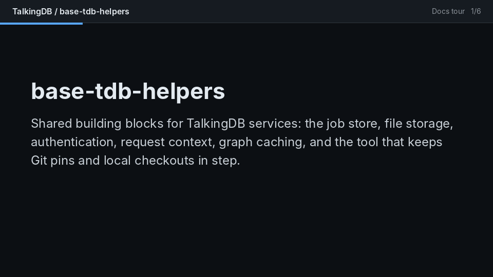

<!-- short-readme -->
<h1 align="center">base-tdb-helpers</h1>

<p align="center"><b>Shared building blocks for TalkingDB services.</b></p>

<p align="center"><a href="#try-it">Try it</a> · <a href="docs/architecture.md">How it works</a> · <a href="docs/usage-and-examples.md">Usage and examples</a> · <a href="docs/troubleshooting.md">Troubleshooting</a> · <a href="docs/reference.md">Full reference</a></p>

<p align="center"><a href="https://github.com/TalkingDB/base-tdb-helpers/stargazers"></a> <a href="https://www.gnu.org/licenses/agpl-3.0.html"></a></p>

<p align="center">
  
</p>
<p align="center"><sub>A real run of <code>talkingdb.helpers.job.store</code> at <code>573c16d</code> against SQLite, 27 Nov 2026.</sub></p>

The job store, file storage, authentication, request context and graph caching that the services share, plus the `make sync` tool that keeps Git pins and local checkouts in step.

## What it does

- **Job store**: every upload is a job in SQLite; cancelling and finishing cannot both win ([usage](docs/usage-and-examples.md)).
- **Files and auth**: storage in [MinIO](https://en.wikipedia.org/wiki/MinIO) and request context for the APIs ([how it works](docs/architecture.md)).
- **`make sync`**: switch between pinned Git commits and editable local checkouts, with a pre-push hook that stops a stale pin.

## Try it

```bash
git clone https://github.com/TalkingDB/base-tdb-helpers.git
cd base-tdb-helpers
poetry install
make install-hooks
```

`make install-hooks` refuses a push when your pins and local checkouts disagree.

## Where it fits

Builds on [base-tdb-models](https://github.com/TalkingDB/base-tdb-models) and [base-tdb-clients](https://github.com/TalkingDB/base-tdb-clients); used by [module-ttt](https://github.com/TalkingDB/module-ttt) and the `package-*` services.

## Learn more

| Page | Read it to |
| :--- | :--- |
| [How it works](docs/architecture.md) | see the parts and how data moves |
| [Usage and examples](docs/usage-and-examples.md) | copy working examples |
| [Troubleshooting](docs/troubleshooting.md) | fix a problem |
| [Full reference](docs/reference.md) | read everything that used to be on this page |
| [All docs](docs/README.md) | see every page |

## Support TalkingDB

If base-tdb-helpers saved you time, please [give it a star](https://github.com/TalkingDB/base-tdb-helpers) ⭐. Stars help other developers find the project.

Found a bug, or a document it gets wrong? [Open an issue](https://github.com/TalkingDB/base-tdb-helpers/issues/new). We are always here to help and open to a conversation. Explore the TalkingDB applications at [talkingdb.io](https://talkingdb.io/#applications).

## License

Licensed under the GNU Affero General Public License v3.0 ([AGPL-3.0](https://www.gnu.org/licenses/agpl-3.0.html)). See [LICENSE](LICENSE).
