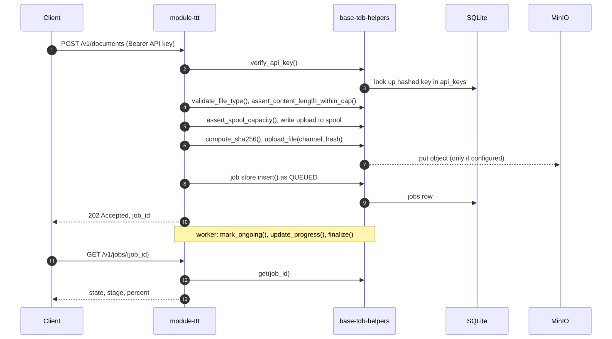

# Architecture

[Docs home](README.md) › Architecture

What each helper does, what it reads and writes, and the settings it uses. For setup, start at the [README](../README.md).

## How a document upload uses these helpers

The clearest way to see the helpers together is to follow one PDF through [module-ttt](https://github.com/TalkingDB/module-ttt), the main service that uses them.

<picture>
  <source media="(prefers-color-scheme: dark)" srcset="images/helpers-used-during-one-document-upload-dark.svg">
  
</picture>

<sub>Diagram source: [helpers-used-during-one-document-upload.mmd](diagrams/helpers-used-during-one-document-upload.mmd). Edit it and re-render with the steps in [docs/diagrams](diagrams/README.md).</sub>

In words: the service checks the caller and the file, parks the upload on disk, stores the original by hash, records a queued job, answers at once, and then moves the job forward in the background while the caller polls.

## File responsibility map

| File | Public functions | Reads or writes | Settings |
| :--- | :--- | :--- | :--- |
| [`job/store.py`](../talkingdb/helpers/job/store.py) | `init_db`, `insert`, `mark_ongoing`, `update_progress`, `request_cancel`, `reset_for_retry`, `finalize`, `get`, `list_documents` | `jobs`, `job_admission` tables | passed in by caller (`max_retries`) |
| [`file_store.py`](../talkingdb/helpers/file_store.py) | `compute_sha256`, `object_path`, `upload_file`, `overwrite_file`, `get_presigned_url`, `stat_file`, `get_file_stream`, `delete_file` | [MinIO](https://en.wikipedia.org/wiki/MinIO) objects at `channel/hash` | MinIO settings in base-tdb-clients |
| [`spool.py`](../talkingdb/helpers/spool.py) | `assert_spool_capacity` and spooling helpers | local disk | `TDB_SPOOL_DIR` (`/var/tmp/tdb-spool`), `TDB_MIN_FREE_SPOOL_MB` (512), `TDB_SPOOL_CHUNK_BYTES` (1 MiB), `TDB_RETRY_AFTER_SECONDS` (30) |
| [`validation.py`](../talkingdb/helpers/validation.py) | `validate_file_type`, `assert_content_length_within_cap`, `supported_upload_types` | nothing | `TDB_MAX_PDF_FILE_SIZE_MB` (100), `TDB_MAX_DOCX_FILE_SIZE_MB` and `TDB_MAX_FILE_SIZE_MB` (50) |
| [`auth.py`](../talkingdb/helpers/auth.py) | `verify_api_key`, `hash_password`, `verify_password` | `api_keys` in `GRAPH_DB` | none |
| [`jwt.py`](../talkingdb/helpers/jwt.py) | `create_access_token`, `get_current_user` | nothing | `JWT_SECRET_KEY` (required), `JWT_ALGORITHM` (HS256), `JWT_ACCESS_TOKEN_EXPIRE_MINUTES` (60) |
| [`graph_cache.py`](../talkingdb/helpers/graph_cache.py) | `get`, `invalidate` | loads `GraphModel` from `GRAPH_DB` | 300 second idle time to live, cleanup every 120 seconds |
| [`namespace/store.py`](../talkingdb/helpers/namespace/store.py) | `upsert_namespace`, `get_namespace`, `list_namespaces`, `list_public_namespaces`, `is_public` | `namespaces` table | none |
| [`project/store.py`](../talkingdb/helpers/project/store.py) | project create, rename, list | `projects` table | none |
| [`file_graph/store.py`](../talkingdb/helpers/file_graph/store.py) | map a job and file hash to the graph built from it | `file_graph_mapping` table | none |
| [`release_channel.py`](../talkingdb/helpers/release_channel.py) | `get_release_channel(request)` | request headers | none; falls back to `localhost` |
| [`request.py`](../talkingdb/helpers/request.py) | `set_request_context`, `get_request_context`, `clear_request_context` | context variables | none |
| [`client.py`](../talkingdb/helpers/client.py) | `config` | `.env` via python-dotenv | `CLIENT_MODE` (`direct` or `api`), `CE_HOST`, `TDB_API_KEY` |

## Two ways to call a sibling service

`CLIENT_MODE` decides how one TalkingDB service calls another. The same idea appears in every package's client (`PTClient`, `DSClient`, `STClient`).

<picture>
  <source media="(prefers-color-scheme: dark)" srcset="images/direct-mode-versus-api-mode-dark.svg">
  
</picture>

<sub>Diagram source: [direct-mode-versus-api-mode.mmd](diagrams/direct-mode-versus-api-mode.mmd). Edit it and re-render with the steps in [docs/diagrams](diagrams/README.md).</sub>

In words: `direct` runs everything in one process with no network; `api` sends the same call over HTTP to a separate service.

## Dependency sync

[`sync_git_deps.py`](../sync_git_deps.py) reads [`git-packages.json`](../git-packages.json) to know each TalkingDB dependency's Git URL and sibling folder, then rewrites the matching lines in `pyproject.toml`.

<picture>
  <source media="(prefers-color-scheme: dark)" srcset="images/what-make-sync-does-dark.svg">
  
</picture>

<sub>Diagram source: [what-make-sync-does.mmd](diagrams/what-make-sync-does.mmd). Edit it and re-render with the steps in [docs/diagrams](diagrams/README.md).</sub>

In words: local mode points at sibling folders; git mode pins to whatever commit those folders are on; a dry run only reports and fails when something would change, which is what the pre-push hook relies on.

## Who depends on this

As of 25 November 2026 two commits of this library are pinned: `1fef6ea` by package-named-entity-linker, package-content-elementizer and module-ttt, and `d7c891b` by package-parse-tree, package-document-search, package-search-trainer and module-ecommerce-ai. Recheck with:

```bash
grep -n 'base-tdb-helpers.git' */pyproject.toml
```

---

**Related:** [Troubleshooting](troubleshooting.md) · [Usage and examples](usage-and-examples.md) · [README](../README.md)
