# base-tdb-helpers: full reference

[Back to the README](../README.md)

Everything that was on the front page before it was shortened, unchanged apart from links, so nothing is lost.

Shared building blocks for TalkingDB services: the job store, file storage, authentication, request context, graph caching, and the tool that keeps Git pins and local checkouts in step.


| Start here | Go deeper |
| :--- | :--- |
| [What it is](#what-it-is) | [Architecture: every helper and what it touches](architecture.md) |
| [Where this fits](#where-this-fits) | [Usage and examples](usage-and-examples.md) |
| [Quickstart](#quickstart) | [Troubleshooting](troubleshooting.md) |
| [Keep Git pins and local checkouts in step](#keep-git-pins-and-local-checkouts-in-step) | [What this repo is not](#what-this-repo-is-not) |

All pages: [docs/](README.md).

## What it is

A **helper** is shared code that more than one service needs and that sits above the raw data shapes. Where [base-tdb-models](https://github.com/TalkingDB/base-tdb-models) says what a job looks like, this library saves the job, moves it from state to state, and cancels it safely. Where [base-tdb-clients](https://github.com/TalkingDB/base-tdb-clients) opens a [MinIO](https://en.wikipedia.org/wiki/MinIO) connection, this library uploads a file by its content hash.

| Area | Main files |
| :--- | :--- |
| Background jobs | [`job/store.py`](../talkingdb/helpers/job/store.py): create, start, progress, cancel, retry and finish ingestion jobs in [SQLite](https://www.sqlite.org/about.html) |
| Files | [`file_store.py`](../talkingdb/helpers/file_store.py) (MinIO by SHA-256 hash), [`spool.py`](../talkingdb/helpers/spool.py) (temporary upload space) |
| Security | [`jwt.py`](../talkingdb/helpers/jwt.py) (login tokens), [`auth.py`](../talkingdb/helpers/auth.py) (API key checks) |
| Graphs | [`graph_cache.py`](../talkingdb/helpers/graph_cache.py) (keeps loaded graphs in memory for 5 minutes), [`graph/store.py`](../talkingdb/helpers/graph/store.py) |
| Organisation | [`namespace/store.py`](../talkingdb/helpers/namespace/store.py), [`project/store.py`](../talkingdb/helpers/project/store.py), [`file_graph/store.py`](../talkingdb/helpers/file_graph/store.py) |
| Requests | [`request.py`](../talkingdb/helpers/request.py), [`release_channel.py`](../talkingdb/helpers/release_channel.py), [`client.py`](../talkingdb/helpers/client.py) |
| Dependency sync | [`sync_git_deps.py`](../sync_git_deps.py), [`git-packages.json`](../git-packages.json), [`git-hooks/pre-push`](../git-hooks/pre-push) |

## Where this fits

<picture>
  <source media="(prefers-color-scheme: dark)" srcset="images/where-base-tdb-helpers-fits-dark.svg">
  
</picture>

<sub>Diagram source: [where-base-tdb-helpers-fits.mmd](diagrams/where-base-tdb-helpers-fits.mmd). Edit it and re-render with the steps in [docs/diagrams](diagrams/README.md).</sub>

In words: helpers build on models and clients, are used by the services, and are the code that actually writes jobs to SQLite and files to MinIO.

## Quickstart

You need Python 3.12 or 3.13, [Poetry](https://python-poetry.org/docs/#installation) and, for `make`, a Bash shell (Linux, macOS or [WSL](https://learn.microsoft.com/en-us/windows/wsl/about)).

```bash
git clone https://github.com/TalkingDB/base-tdb-helpers.git
cd base-tdb-helpers
poetry install
make install-hooks
```

`make install-hooks` copies [`git-hooks/pre-push`](../git-hooks/pre-push) into `.git/hooks/`, so a push is refused when your pins are out of step with your local checkouts.

## Keep Git pins and local checkouts in step

TalkingDB repositories depend on each other by Git commit. [`sync_git_deps.py`](../sync_git_deps.py) rewrites those lines in `pyproject.toml` for you. The same script and `Makefile` targets are copied into every package and module.

| Command | What it does to `pyproject.toml` |
| :--- | :--- |
| `make sync MODE=local` | Points each TalkingDB dependency at the sibling folder (`../base-tdb-models`) as an editable path, for side by side development |
| `make sync MODE=git` | Points each dependency back at GitHub, pinned to the **current HEAD of your sibling checkout** |
| `make sync-dry-run MODE=git` | Prints what would change and exits with code 1 if anything would |

> [!WARNING]
> `make sync MODE=git` is a pin bump. It moves every pin to whatever commit your sibling folders are on, including unmerged branches. Review the `pyproject.toml` diff before you commit it.

Folder layout the script expects (from [`git-packages.json`](../git-packages.json)):

```text
workspace/
├── base-tdb-models/
├── base-tdb-clients/
└── base-tdb-helpers/   <- run make here
```

## What this repo is not

- **Not a service.** It has no server of its own; the FastAPI pieces (`jwt.py`, `spool.py`, `release_channel.py`) are used inside other services.
- **Not the job worker.** It stores and transitions jobs. Running the work is done by the service that owns the job, today [module-ttt](https://github.com/TalkingDB/module-ttt).
- **Not a secrets manager.** `JWT_SECRET_KEY` and MinIO keys come from the environment of the service that uses them.

## Related repositories

| Repository | Relationship |
| :--- | :--- |
| [base-tdb-models](https://github.com/TalkingDB/base-tdb-models) | The shapes these helpers save and load |
| [base-tdb-clients](https://github.com/TalkingDB/base-tdb-clients) | The SQLite and MinIO connections these helpers use |
| [module-ttt](https://github.com/TalkingDB/module-ttt) | Main user of the job store, file store, spool and auth helpers |
| [infra-tdb-platform](https://github.com/TalkingDB/infra-tdb-platform) | Runs `make sync` across every repository at once |

## Further reading

- [Poetry Git and path dependencies](https://python-poetry.org/docs/dependency-specification/)
- [FastAPI security with OAuth2 and JWT](https://fastapi.tiangolo.com/tutorial/security/oauth2-jwt/)
- [Git hooks](https://git-scm.com/book/en/v2/Customizing-Git-Git-Hooks)

## Code contributor

mayank.g@smarter.codes
